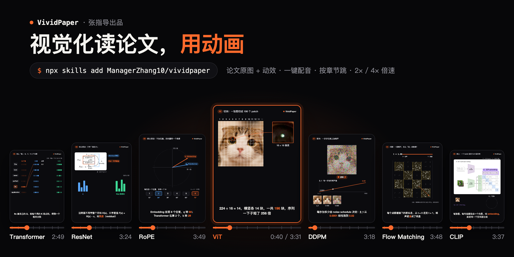
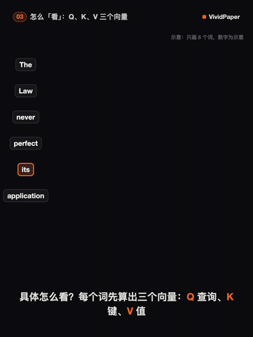
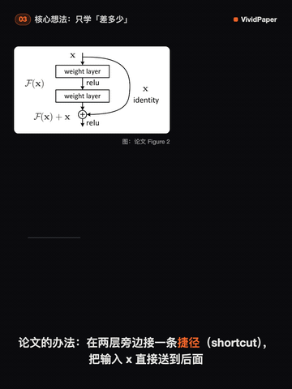
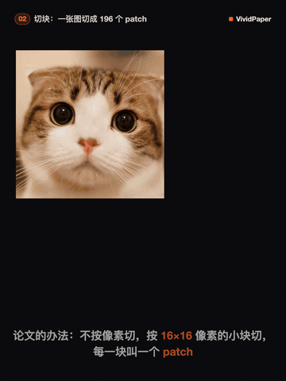
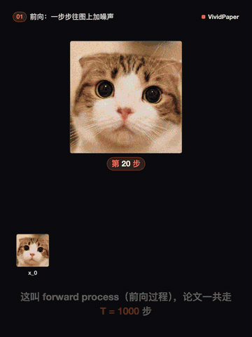
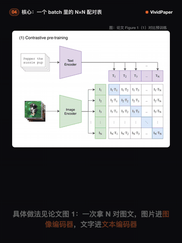
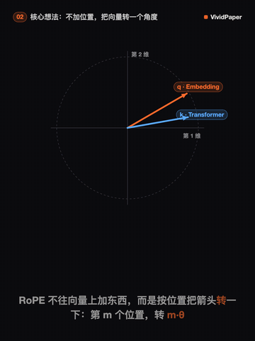
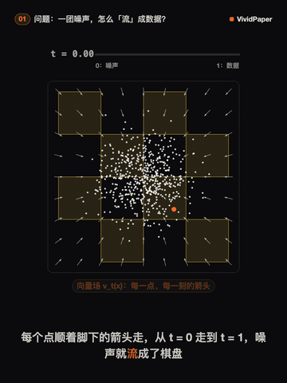

# VividPaper · 视觉化读论文

[](https://managerzhang10.github.io/vividpaper/)

**张指导出品。** 给你的 AI 编程助手（Claude Code、Codex 等）装上这个 skill，丢给它一篇论文，它会做出一个**动效解读页**：一个双击就能在浏览器里打开的 HTML 文件，用论文自己的图加上动画，一幕一幕讲清这篇论文解决什么问题、核心做法是什么、为什么有效、效果多好。

还能**一键配音**：免费的中文男声把字幕念出来，画面和动作跟着声音走。

不是文字总结，也不是 PPT。看完你能用自己的话把这篇论文讲出来。

**▶ 在线看全部示例：https://managerzhang10.github.io/vividpaper/**（点开即播，带配音，不用下载）

<table>
<tr>
<td align="center" width="25%"><a href="https://managerzhang10.github.io/vividpaper/examples/attention/attention.html"></a><br><b>Transformer</b></td>
<td align="center" width="25%"><a href="https://managerzhang10.github.io/vividpaper/examples/resnet/resnet.html"></a><br><b>ResNet</b></td>
<td align="center" width="25%"><a href="https://managerzhang10.github.io/vividpaper/examples/vit/vit.html"></a><br><b>ViT</b></td>
<td align="center" width="25%"><a href="https://managerzhang10.github.io/vividpaper/examples/ddpm/ddpm.html"></a><br><b>DDPM</b></td>
</tr>
<tr>
<td align="center" width="25%"><a href="https://managerzhang10.github.io/vividpaper/examples/clip/clip.html"></a><br><b>CLIP</b></td>
<td align="center" width="25%"><a href="https://managerzhang10.github.io/vividpaper/examples/rope/rope.html"></a><br><b>RoPE</b></td>
<td align="center" width="25%"><a href="https://managerzhang10.github.io/vividpaper/examples/flow-matching/flow-matching.html"></a><br><b>Flow Matching</b></td>
<td></td>
</tr>
</table>

## 示例

| 论文 | 一句话主线 | 在线看 | 时长 |
| --- | --- | --- | --- |
| Attention Is All You Need（2017） | 翻译模型能不能完全不用 RNN，只靠注意力？ | [▶ Transformer](https://managerzhang10.github.io/vividpaper/examples/attention/attention.html) | 2:59 |
| Deep Residual Learning（2015） | 网络越堆越深，为什么反而越训越差？ | [▶ ResNet](https://managerzhang10.github.io/vividpaper/examples/resnet/resnet.html) | 3:37 |
| An Image is Worth 16x16 Words（2020） | 图像能不能像句子一样，直接交给 Transformer？ | [▶ ViT](https://managerzhang10.github.io/vividpaper/examples/vit/vit.html) | 3:40 |
| Denoising Diffusion Probabilistic Models（2020） | 怎么从纯噪声一步步「洗」出一张图？ | [▶ DDPM](https://managerzhang10.github.io/vividpaper/examples/ddpm/ddpm.html) | 3:31 |
| Learning Transferable Visual Models（2021） | 不给人工标签，模型能不能光靠网上的图文配对学会认图？ | [▶ CLIP](https://managerzhang10.github.io/vividpaper/examples/clip/clip.html) | 3:46 |
| RoFormer: Rotary Position Embedding（2021） | 注意力分不清词序，怎样让分数只看两个词隔多远？ | [▶ RoPE](https://managerzhang10.github.io/vividpaper/examples/rope/rope.html) | 3:58 |
| Flow Matching for Generative Modeling（2022） | 一团噪声要流成数据，每一点该往哪走，怎么教给模型？ | [▶ Flow Matching](https://managerzhang10.github.io/vividpaper/examples/flow-matching/flow-matching.html) | 3:58 |

动图是每部片子核心一幕的 8–10 秒片段（动图没有声音）。打开后：空格播放/暂停，←/→ 跳 5 秒，1/2/4 切倍速，M 开关声音，右侧章节可以直接跳。想离线看就下载 `examples/<名字>/<名字>.html` 双击打开，单文件、配音也在里面，不联网也能放。

## 安装

```bash
npx skills add ManagerZhang10/vividpaper
```

或者手动：把 `skills/vividpaper/` 复制（或软链）到你的 agent 的 skills 目录，例如 `~/.claude/skills/vividpaper`、`~/.codex/skills/vividpaper`。

依赖：Python 3、`pip install pymupdf`、本机装有 Google Chrome（自查要用，路径不标准时设环境变量 `CHROME`）。配音另需 `pip install -U edge-tts`，不配音可以不装。这些装好就能用 Flash 版；标准版是可选项，见下一节。

## 两个版本

流程、字幕、配音、播放器和自查两个版本都一样，区别在画面怎么画。agent 开工前会先跑 `standard.py doctor` 看标准版装没装：装了就用标准版，没装就问你选哪个。

| | 标准版 | Flash 版 |
| --- | --- | --- |
| 画面 | [HyperFrames](https://github.com/heygen-com/hyperframes)：每一幕是一段 HTML / CSS / SVG + GSAP 动画，画法交给 HyperFrames 自带的 skill，上限高 | 自带的 canvas 引擎 `pm.js`，`film.js` 里用 `g.*` 画 |
| 要装什么 | 上面的依赖之外，再要 Node ≥ 22，然后 `python3 skills/vividpaper/scripts/standard.py install`：按锁定版本装 hyperframes 0.9.19、GSAP 和中文字体，约 120 MB，只装在 skill 目录的 `node_modules/` 里，不碰全局 | 不用再装 |
| 浏览器 | 用本机 Chrome；没有时可以让 HyperFrames 下一个 chrome-headless-shell（约 190 MB，`install --browser`） | 本机 Chrome |
| 版式 | 3:4、9:16 竖屏、16:9 横屏 | 3:4、9:16 竖屏 |
| 出 mp4 | `build.py <短名> --mp4`，音轨和网页里听到的一样（要 ffmpeg 和 ffprobe） | 不支持，只出网页 |
| 成片 | 单文件 HTML，比 Flash 版多约 1 MB（内嵌 HyperFrames 运行时、GSAP 和按片子裁剪的字体） | 单文件 HTML |

标准版的几点说明：

- **遥测**：HyperFrames 的命令行默认会上报使用数据（登录后关联账号）。本仓库的脚本调它时一律关掉（`HYPERFRAMES_NO_TELEMETRY=1`、`DO_NOT_TRACK=1`），也不跑 `publish` 之类的上传命令；缓存和浏览器临时目录放在一次性的临时目录里，跑完删掉。
- **字体**：中文用 Noto Sans SC（OFL-1.1），build 时只取片子用到的字内嵌进 HTML，不走 Google Fonts，离线能看。
- **GSAP 授权**：GSAP 用的是它自己的 [Standard "no charge" license](https://gsap.com/standard-license)，免费、可以商用，但不是 OSI 意义上的开源许可，有它自己的条款，介意的话先读原文；每个标准版成片里都内嵌了一份 GSAP。HyperFrames 是 Apache-2.0。

## 用法

对你的 agent 说：

> 用 vividpaper 把 arxiv.org/abs/1706.03762 做成动效解读

它会按 [SKILL.md](skills/vividpaper/SKILL.md) 的流程走：先看标准版装没装 → 拉原文和原图 → 定一个主线问题和一个贯穿全片的例子 → 拆成 5–8 幕 → 裁论文原图、写动效 → 打包成单文件 HTML → 无头 Chrome 自查（出界、字太小、压字幕、画面不动），没问题才交给你。

**可选一键配音**：再说一句「给它配个音」，或者自己跑 `voice.py <短名>`。用的是免费的 edge-tts 中文男声，不用 API key；字幕和动作跟着声音走，看的人随时可以点 🔊 或按 M 关掉声音。

```bash
python3 skills/vividpaper/scripts/voice.py <短名>    # 默认云希男声；--voice zh-CN-YunyangNeural 换声音
python3 skills/vividpaper/scripts/build.py <短名>    # 有 voice/ 就把配音打包进 HTML
```

## 它是怎么做的

- **每一帧都是时间 t 的纯函数**：同一个 t 永远画出同一帧，所以可以随意拖进度、4 倍速看，也能在无头浏览器里逐帧自查。
- **画面讲机制，字幕讲句子**：每句字幕都配一个画面动作（出现、连线、标框），论文原图上讲到哪框到哪。
- **声音当时钟**：配了音以后，每句字幕念完才切下一句，挂在字幕上的动作自动跟着声音走；拖进度、跳章节、2× 都同步。公式会先改成能念的说法（`x_t` 念「x t」），念不好的句子可以单独写念法。
- **真图真数**：架构图、可视化直接裁论文原图并标出处；结果画成条形图，数字只从原文取，示意数字标「示意」。

Flash 版的画法规则见 [craft.md](skills/vividpaper/references/craft.md)，接口见 [api.md](skills/vividpaper/references/api.md)；标准版的约定和接口见 [standard.md](skills/vividpaper/references/standard.md)。

## 许可

代码 MIT。`examples/` 里的论文插图版权归原作者，仅用于解读并在画面上注明出处。标准版的依赖各有许可：HyperFrames Apache-2.0、GSAP Standard "no charge" license、Noto Sans SC OFL-1.1（见上文「两个版本」）。
