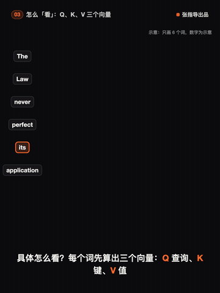
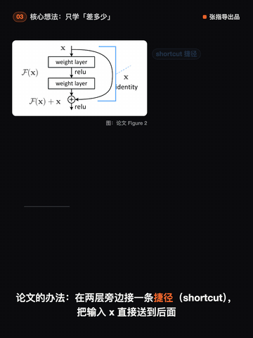
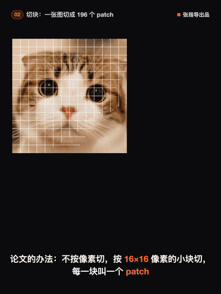
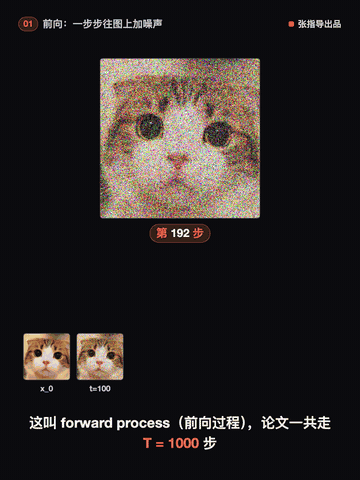
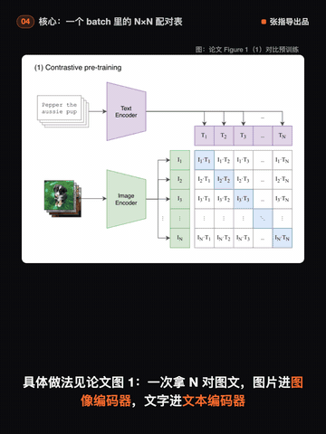

# paper-motion · 3 分钟看懂一篇论文

**张指导出品。** 给你的 AI 编程助手（Claude Code、Codex 等）装上这个 skill，丢给它一篇论文，它会做出一个约 3 分钟的**动效解读页**：一个双击就能在浏览器里打开的 HTML 文件，用论文自己的图加上动画，一幕一幕讲清这篇论文解决什么问题、核心做法是什么、为什么有效、效果多好。

不是文字总结，也不是 PPT。读一篇论文的摘要要 3 分钟，看完这个动效也是 3 分钟，但看完你能用自己的话把它讲出来。

**▶ 在线看全部示例：https://managerzhang10.github.io/paper-motion/**（点开即播，不用下载）

<table>
<tr>
<td align="center" width="20%"><a href="https://managerzhang10.github.io/paper-motion/examples/attention/attention.html"></a><br><b>Transformer</b></td>
<td align="center" width="20%"><a href="https://managerzhang10.github.io/paper-motion/examples/resnet/resnet.html"></a><br><b>ResNet</b></td>
<td align="center" width="20%"><a href="https://managerzhang10.github.io/paper-motion/examples/vit/vit.html"></a><br><b>ViT</b></td>
<td align="center" width="20%"><a href="https://managerzhang10.github.io/paper-motion/examples/ddpm/ddpm.html"></a><br><b>DDPM</b></td>
<td align="center" width="20%"><a href="https://managerzhang10.github.io/paper-motion/examples/clip/clip.html"></a><br><b>CLIP</b></td>
</tr>
</table>

## 示例

| 论文 | 一句话主线 | 在线看 | 时长 |
| --- | --- | --- | --- |
| Attention Is All You Need（2017） | 翻译模型能不能完全不用 RNN，只靠注意力？ | [▶ Transformer](https://managerzhang10.github.io/paper-motion/examples/attention/attention.html) | 2:30 |
| Deep Residual Learning（2015） | 网络越堆越深，为什么反而越训越差？ | [▶ ResNet](https://managerzhang10.github.io/paper-motion/examples/resnet/resnet.html) | 2:39 |
| An Image is Worth 16x16 Words（2020） | 图像能不能像句子一样，直接交给 Transformer？ | [▶ ViT](https://managerzhang10.github.io/paper-motion/examples/vit/vit.html) | 2:50 |
| Denoising Diffusion Probabilistic Models（2020） | 怎么从纯噪声一步步「洗」出一张图？ | [▶ DDPM](https://managerzhang10.github.io/paper-motion/examples/ddpm/ddpm.html) | 2:33 |
| Learning Transferable Visual Models（2021） | 不给人工标签，模型能不能光靠网上的图文配对学会认图？ | [▶ CLIP](https://managerzhang10.github.io/paper-motion/examples/clip/clip.html) | 2:56 |

动图是每部片子核心一幕的 8–10 秒片段。打开后：空格播放/暂停，←/→ 跳 5 秒，1/2/4 切倍速，右侧章节可以直接跳。想离线看就下载 `examples/<名字>/<名字>.html` 双击打开，单文件、不联网也能放。

## 安装

```bash
npx skills add ManagerZhang10/paper-motion
```

或者手动：把 `skills/paper-motion/` 复制（或软链）到你的 agent 的 skills 目录，例如 `~/.claude/skills/paper-motion`、`~/.codex/skills/paper-motion`。

依赖：Python 3、`pip install pymupdf`、本机装有 Google Chrome（自查要用，路径不标准时设环境变量 `CHROME`）。

## 用法

对你的 agent 说：

> 用 paper-motion 把 arxiv.org/abs/1706.03762 做成动效解读

它会按 [SKILL.md](skills/paper-motion/SKILL.md) 的流程走：拉原文和原图 → 定一个主线问题和一个贯穿全片的例子 → 拆成 5–8 幕 → 裁论文原图、写动效 → 打包成单文件 HTML → 无头 Chrome 自查（出界、字太小、压字幕、画面不动），没问题才交给你。

## 它是怎么做的

- **每一帧都是时间 t 的纯函数**：同一个 t 永远画出同一帧，所以可以随意拖进度、4 倍速看，也能在无头浏览器里逐帧自查。
- **画面讲机制，字幕讲句子**：每句字幕都配一个画面动作（出现、连线、标框），论文原图上讲到哪框到哪。
- **真图真数**：架构图、可视化直接裁论文原图并标出处；结果画成条形图，数字只从原文取，示意数字标「示意」。

画法规则见 [craft.md](skills/paper-motion/references/craft.md)，接口见 [api.md](skills/paper-motion/references/api.md)。

## 许可

代码 MIT。`examples/` 里的论文插图版权归原作者，仅用于解读并在画面上注明出处。
